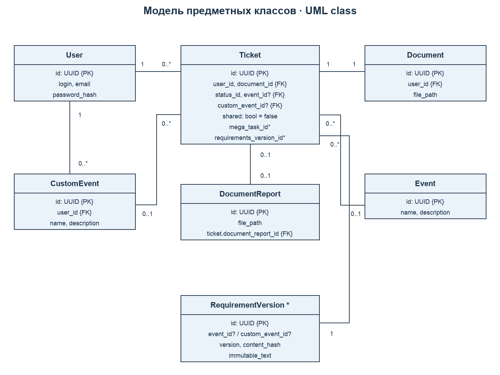
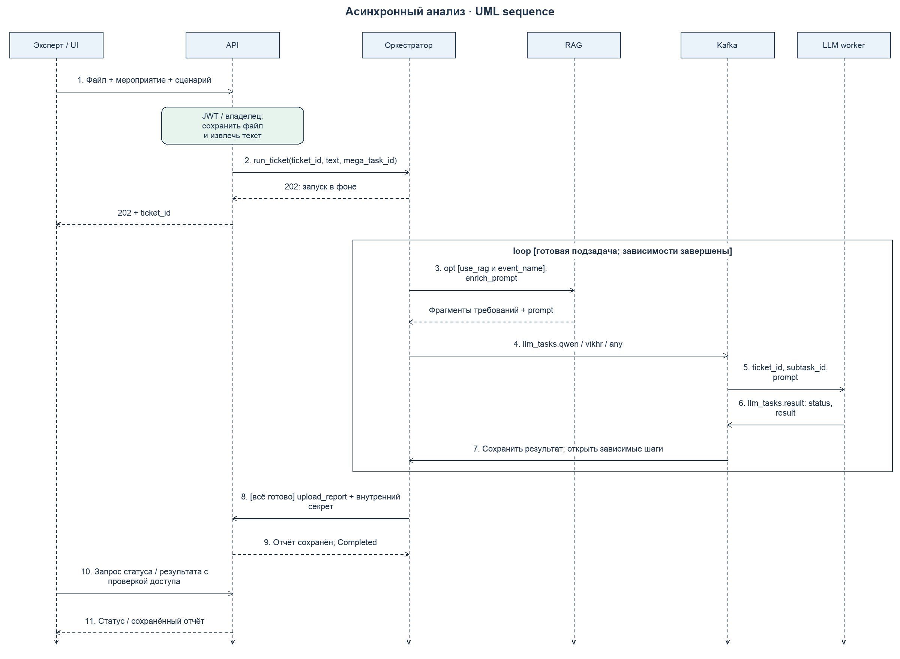
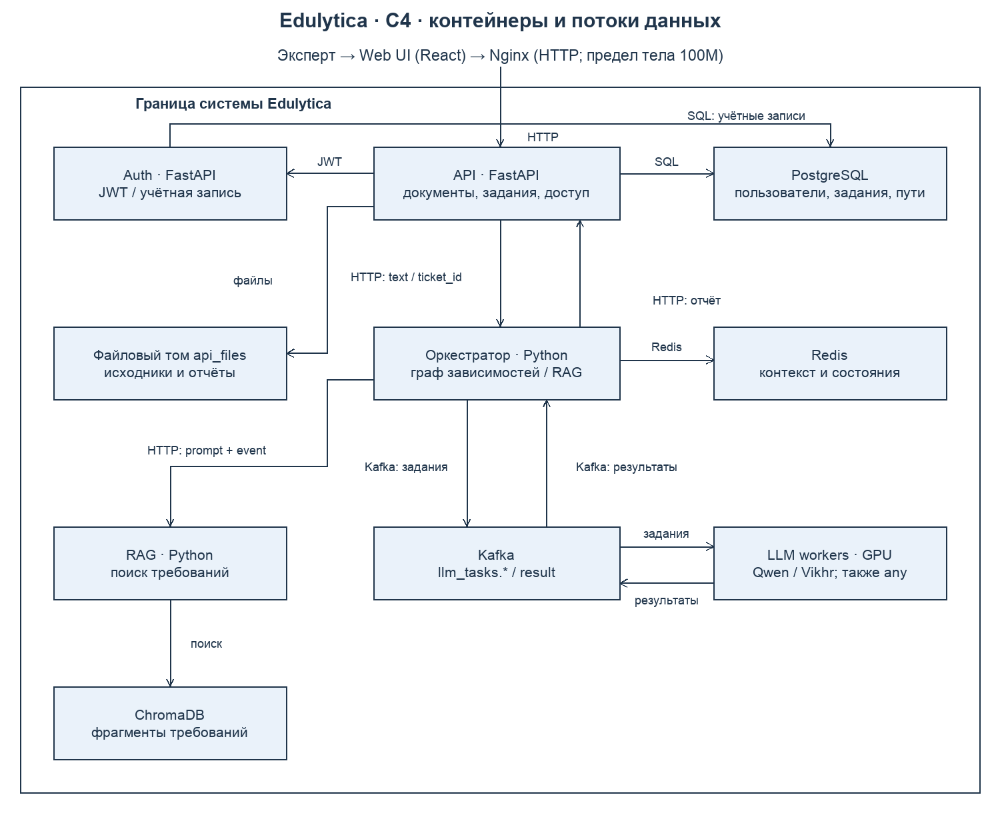
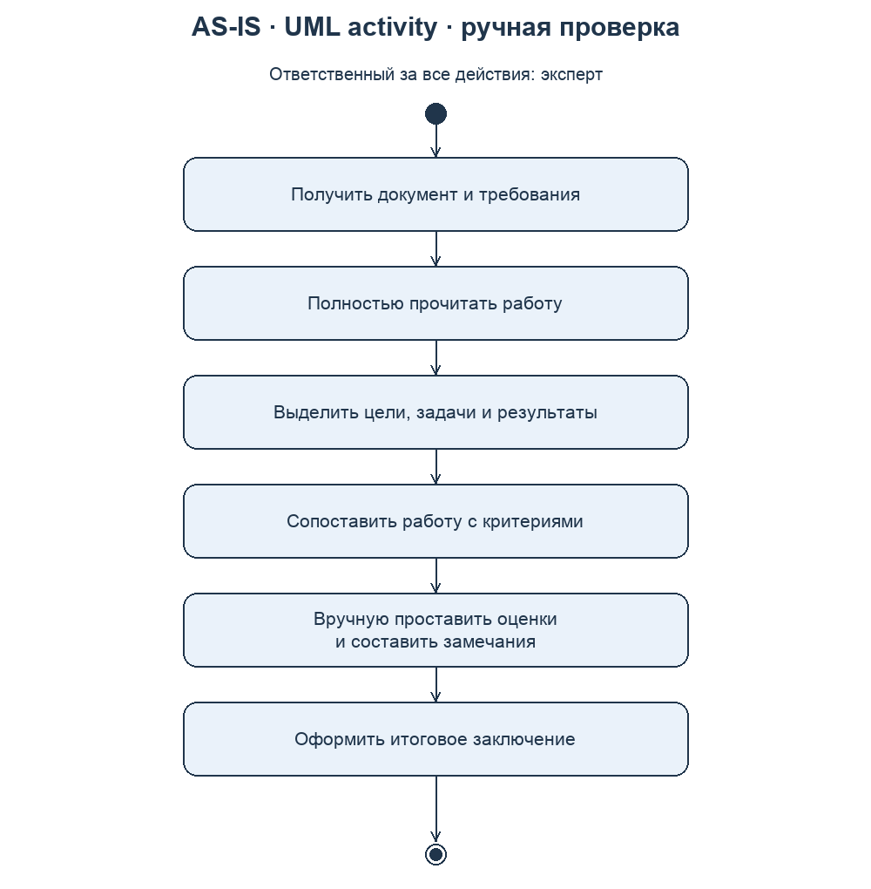
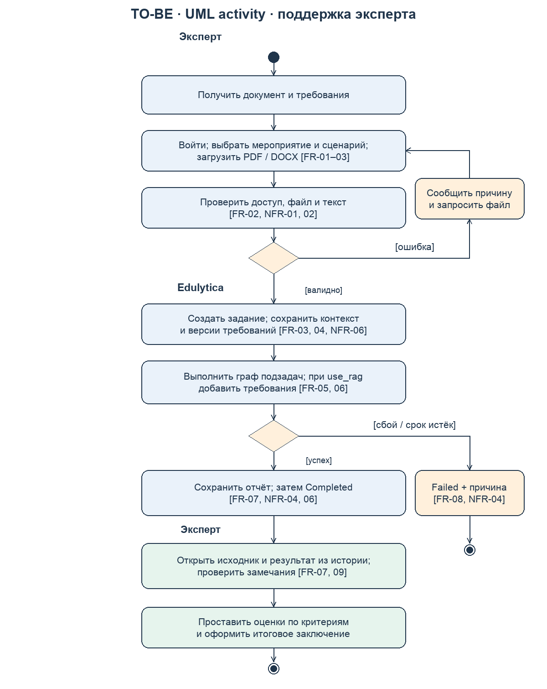

# ЛР 3 — проектирование

**Тема ВКР:** Проект Edulytica: проектирование системы поддержки экспертного анализа выпускных квалификационных работ и научных статей на основе больших языковых моделей.

**Область работы:** серверная часть: API, обработка документов, хранение данных, управление заданиями и взаимодействие с сервисами моделей.

**Автор:** Шафиков Максим Азатович

## 1. Предметная область и требования

### Описание предметной области

Edulytica подготавливает вспомогательные материалы для эксперта, который проверяет ВКР или рецензирует научную статью. Без такой системы эксперт получает документ, полностью читает его, вручную сопоставляет содержание с критериями, проставляет оценки и составляет замечания. Требования определяются видом работы и выбранным мероприятием.

Система принимает документ, извлекает текст и выполняет выбранный сценарий LLM-анализа. Пользователь получает предварительные выводы и может вернуться к исходнику. Оценки по критериям и итоговое заключение остаются ответственностью эксперта. Автоматическое принятие решения о защите или публикации в границы проекта не входит.

Основной пользователь — эксперт. В серверной модели это зарегистрированный пользователь, которому принадлежат документы и задания. Поддерживаются стандартные мероприятия и пользовательские мероприятия с собственными требованиями.

### Серверная часть Edulytica

Система построена из отдельных сервисов: пользовательские запросы, управление анализом и выполнение моделей разделены между компонентами. Структура `src/` отражает это разделение.

| Компонент | Каталог | Назначение и взаимодействия |
|---|---|---|
| Веб-интерфейс | `src/front_end/` | Предоставляет формы входа, загрузки документов и выбора мероприятия, показывает историю заданий и результаты. Обращается к серверной части через шлюз. |
| Шлюз nginx | `src/gateway/` | Принимает HTTP-запросы, направляет их в Auth или API и ограничивает размер тела запроса. |
| Сервис аутентификации | `src/auth/` | Управляет регистрацией, входом и токенами пользователей. Использует PostgreSQL для хранения учётных данных. |
| Основной API | `src/edulytica_api/` | Принимает и разбирает документы, управляет заданиями и мероприятиями, проверяет доступ, сохраняет и выдаёт результаты. Работает с PostgreSQL и файловым томом, передаёт задания оркестратору по HTTP. |
| Оркестратор | `src/orchestration/` | Управляет графом зависимых подзадач и состояниями в Redis, запрашивает контекст у RAG, отправляет задания моделям через Kafka. Получает результаты, собирает отчёт и передаёт его в API. |
| Сервис RAG | `src/rag/` | Подбирает фрагменты требований выбранного мероприятия и дополняет ими контекст анализа. Использует ChromaDB для поиска и PostgreSQL для данных мероприятий. |
| Обработчики моделей | `src/models/` | Выполняют LLM-генерацию на GPU. Для Qwen и Vikhr запускаются отдельные экземпляры обработчиков, которые получают подзадачи из Kafka и публикуют результаты в общий топик. |
| Резервное копирование | `src/backup/` | По расписанию создаёт копию PostgreSQL и архив файлов документов и результатов. |
| Общая библиотека | `src/common/` | Содержит модели и операции БД, настройки, средства проверки токенов, журналирования и общие утилиты, используемые сервисами. |

PostgreSQL, Redis, Kafka и ChromaDB развёртываются как инфраструктурные компоненты. PostgreSQL хранит пользователей, задания и связи документов, Redis — оперативное состояние анализа, Kafka — сообщения между оркестратором и обработчиками, ChromaDB — индекс требований. Исходники документов и готовые отчёты хранятся в файловом томе API. Общая библиотека подключается к сервисам как код, а остальные компоненты взаимодействуют по HTTP, через Kafka или через соответствующие хранилища.

Система по умолчанию поддерживает 2 сценария анализа. В сценарии `1` реализован развёрнутый анализ с несколькими группами зависимых подзадач и выборочным обращением к RAG. В сценарии `2` выполняются два последовательных шага: извлечение целей и задач, затем оценка соответствия содержания этим целям и задачам.

Для развития серверной части предусмотрены версионирование требований, атомарный захват подзадачи, дедупликация результатов и контроль зависших заданий.

### Функциональные требования

| ID | Требование | Как проверить выполнение |
|---|---|---|
| FR-01 | Система должна аутентифицировать пользователя и проверять право доступа к заданиям, документам и результатам. Общий доступ должен включаться владельцем явно. | Пользователь B не получает закрытое задание A; после разрешения общего доступа получает доступ только в предусмотренном режиме. Без токена закрытые материалы недоступны. |
| FR-02 | Система должна принимать PDF и DOCX, сохранять исходник и извлекать текст. Неподдерживаемый формат, повреждённый файл и отсутствие извлекаемого текста должны приводить к понятной ошибке без запуска LLM. | Загрузить корректные PDF/DOCX, повреждённый файл, иной формат и PDF без текстового слоя; проверить исходник и отсутствие задач Kafka при отказе. OCR в этой работе не проектируется. |
| FR-03 | Пользователь должен выбирать стандартное либо собственное мероприятие и сценарий `1` или `2`. Задание должно сохранять выбранный контекст. | Создать задания обоих сценариев и видов мероприятий; проверить связи и запрет выбора чужого пользовательского мероприятия. Неизвестный сценарий отклоняется. |
| FR-04 | После подготовки документа система должна создавать задание с идентификатором и запускать анализ в фоне, предоставляя историю и статус независимо от длительности генерации. | Получить 202 и `ticket_id` до завершения генерации; открыть историю и запросить состояние выполняемого задания. |
| FR-05 | Оркестратор должен выполнять подзадачи с учётом зависимостей и передавать их в подходящие очереди моделей; сценарий `2` должен выполнять `1.1` перед `1.2`. | По сообщениям и состояниям убедиться, что зависимый шаг запускается после успешного завершения всех предшественников и получает их результаты. |
| FR-06 | Для заранее определенных шагов сценария `1` система должна включать требования выбранного мероприятия в контекст анализа. | На двух наборах требований проверить состав переданного контекста; для сценария `2` подтвердить отсутствие RAG-вызова. |
| FR-07 | Система должна собирать и сохранять результат анализа, связывать его с заданием и предоставлять владельцу исходник и отчёт. | После завершения открыть и скачать исходник и результат, повторить запрос после перезапуска API. |
| FR-08 | При сбое модели, RAG или сохранения отчёта система должна фиксировать ошибку и показывать Failed вместо успешного завершения. | Подменить зависимый сервис ошибкой, проверить причину отказа и отсутствие ложного Completed. |
| FR-09 | Эксперт должен иметь возможность сопоставить предварительные выводы с исходным текстом перед выставлением итоговых оценок. | Из одного задания открыть исходник и результат; пройти сценарий проверки замечаний. Итоговая оценка оформляется экспертом вне автоматического решения модели. |

### Нефункциональные требования

Для проверки нефункциональных требований заданы следующие критерии приёмки.

| ID | Требование | Как проверить выполнение |
|---|---|---|
| NFR-01 | При стандартной конфигурации nginx тело HTTP-запроса не должно превышать `100M` (100 MiB = 104 857 600 байт). Лимит должен изменяться конфигурацией. | Проверить запросы ниже и выше границы; превышение возвращает 413 до обработки. Повторить с изменённой настройкой. При multipart файл должен быть меньше лимита на размер служебных полей. |
| NFR-02 | Проверка доступа должна выполняться для каждого чтения/изменения задания и выдачи файла. Пароли и токены не должны попадать в журналы; внутренний метод сохранения отчёта должен требовать служебный секрет. | Выполнить отрицательные проверки чужих UUID и пользовательских мероприятий, отключённой общей ссылки, неверного внутреннего секрета; проверить журналы тестового запуска. |
| NFR-03 | При 10 одновременных клиентах, опрашивающих состояние раз в 2 секунды, p95 времени ответа истории и статуса должен быть не более 2 секунд в течение 10 минут при работающем анализе. | Измерить задержки и долю ошибок на фиксированном стенде и одинаковом наборе заданий. Загрузка, разбор документа и генерация не входят в этот норматив. |
| NFR-04 | Повтор результата одной подзадачи не должен повторно запускать зависимые шаги или создавать второй итоговый отчёт. Задание должно переходить в Failed не позднее 60 секунд после истечения настраиваемого предельного срока обработки. | Дважды доставить результат, в том числе одновременно; остановить worker; проверить единственность запуска и отчёта, срабатывание контроля срока и отсутствие позднего перехода Failed → Completed. |
| NFR-05 | На зафиксированном стенде с одним экземпляром каждой используемой модели целевой p95 полного анализа без очереди — до 10 минут для сценария `1` и до 3 минут для сценария `2`. | Выполнить по 20 последовательных запусков на неизменной выборке текстовых документов объёмом 10–30 тыс. слов, до 10 MiB; модели предварительно загружены. Измерять от 202 до доступности отчёта, фиксировать также ошибки. |
| NFR-06 | Для каждого задания должны сохраняться идентификаторы документа, сценария, версии требований и конфигурации моделей/промптов. Переходы состояний должны журналироваться с `ticket_id`, `subtask_id`, временем и причиной ошибки без полного текста документа. | По идентификатору восстановить состав входных данных и последовательность обработки; изменение требований мероприятия не меняет контекст уже созданной задачи. |

## 2. Обзор нотаций и видов диаграмм

В обзор включены десять позиций. Виды UML рассматриваются отдельно, поскольку решают разные задачи проектирования. При описании UML использована [спецификацией OMG UML 2.5.1](https://www.omg.org/spec/UML/2.5.1/About-UML), BPMN — [спецификацией OMG BPMN 2.0.2](https://www.omg.org/spec/BPMN/2.0.2/About-BPMN).

| Нотация или вид диаграммы | Что описывает | Сильные стороны для проектирования ИС |
|---|---|---|
| BPMN | Бизнес-процессы, участников, события и обмен сообщениями | Подходит для обсуждения процесса проверки с экспертом; явно показывает ответственность и исключения. |
| ER-модель | Сущности данных, ключи и связи | Помогает определить структуру БД и проверить кратности связей. |
| DFD | Потоки данных между процессами, хранилищами и внешними участниками | Позволяет проследить путь документа и результата без детализации программных классов. |
| UML use case | Цели пользователей и функции системы | Уточняет границы автоматизации и доступные действия эксперта. |
| UML class | Классы, атрибуты, связи и ограничения | Связывает предметную область с серверной моделью и будущими ограничениями БД. |
| UML sequence | Упорядоченные сообщения между участниками | Показывает асинхронный запуск, ответы сервисов и момент сохранения результата. |
| UML activity | Действия, переходы и условия выбора | Позволяет сравнить ручной и автоматизированный процесс в одинаковых границах. |
| UML state machine | Состояния объекта и условия переходов | Полезна для проверки жизненного цикла задания и запрета некорректных переходов. |
| UML deployment | Узлы исполнения и размещение программных артефактов | Помогает отдельно описать CPU/GPU-узлы, сети и условия эксплуатации. |
| C4, уровень контейнеров | Приложения, хранилища, обязанности и связи | Даёт общую картину серверной архитектуры и используемых технологий. Размещение и репликация требуют отдельной модели. |

Уровень контейнеров C4 выбран в значении приложения или хранилища, а не обязательно Docker-контейнера; это соответствует [описанию C4 Container diagram](https://c4model.com/diagrams/container).

## 3. Выбор нотаций для проекта

Выбраны четыре вида моделей. UML activity раскрывает бизнес-логику проверки, UML class — данные, UML sequence — взаимодействия во времени, C4 — границы сервисов и потоки между ними.

| Нотация или вид диаграммы | Что моделируется | Требования | Обоснование |
|---|---|---|---|
| UML activity | Проверка работы от получения документа до заключения | FR-01–09; NFR-01, 02, 04, 06 | Позволяет показать автоматизируемую часть, ошибочные ветви и обязательную проверку экспертом; AS-IS и TO-BE сопоставимы. |
| UML class | Предметные сущности и связи хранения | FR-01, 03, 07; NFR-02, 04, 06 | Показывает принадлежность данных, необязательный результат до завершения и привязку версии требований. |
| UML sequence | Загрузка, запуск, обмен сообщениями, завершение и получение результата | FR-02, 04–08; NFR-03–06 | Разделяет принятие задания и окончание вычисления, позволяет обсуждать повторы и момент подтверждения успеха. |
| C4, контейнеры | API, Auth, оркестратор, RAG, обработчики и хранилища | FR-01, 02, 04–08; NFR-01–06 | Закрепляет ответственность за доступ, состояние и генерацию; показывает места контроля и возможные узкие места. |

Модели связывают требования с проектными решениями. Производительность, устойчивость к сбоям и качество ответов проверяются при испытаниях системы.

## 4. Модели системы

### 4.1. Предметная модель — UML class

Показаны основные классы хранения, без технических таблиц токенов и кодов подтверждения. Это предметная модель, а не полная физическая схема БД. `Ticket` принадлежит одному пользователю и связан ровно с одним `Document`; у пользователя может быть несколько заданий. В текущей ORM `document_id` уникален: повторный анализ в этой модели создаёт отдельную запись документа. `DocumentReport` появляется после завершения и может быть связан не более чем с одним заданием. Справочники типа и статуса в рисунке свёрнуты в атрибуты задания.

Кратность `0..1` на обоих концах связи Ticket–DocumentReport означает: задание может ещё не иметь отчёта, а запись отчёта до привязки может существовать самостоятельно. В успешно завершённом задании отчёт обязателен. Файл хранится в файловом томе, в PostgreSQL записываются путь и связи.

Стандартное мероприятие `Event` доступно для выбора, `CustomEvent` принадлежит пользователю. Для задания выбирается ровно один из двух видов мероприятия. Целевые ограничения: XOR для `event_id` и `custom_event_id`, совпадение владельцев задания и документа, запрет выбора чужого CustomEvent.

**Функциональные требования:** FR-01 отражено связями владельца; FR-03 — мероприятием и сценарием; FR-07 — документом и отчётом. **Нефункциональные требования:** NFR-02 поддерживается принадлежностью данных и явным `shared=false`; NFR-06 — версией требований. Для NFR-04 создание и присоединение отчёта должны быть идемпотентными.

### 4.2. Взаимодействия — UML sequence

API проверяет доступ, сохраняет файл и извлекает текст. Затем отправляет оркестратору `ticket_id`, текст и номер сценария. Оркестратор принимает запуск в фоновую обработку, а пользователь получает 202 с идентификатором. Приём запроса не означает готовность результата.

В цикле запускаются только готовые подзадачи. Для шагов с флагом `use_rag=True` и выбранным мероприятием RAG обогащает промпт. Оркестратор публикует сообщение в `llm_tasks.qwen`, `llm_tasks.vikhr` либо `llm_tasks.any`. Последний топик обрабатывают доступные обработчики, подписанные на него; он не является отдельной моделью. Ответ поступает в `llm_tasks.result` и содержит `ticket_id`, `subtask_id`, статус и результат.

Успешный результат разблокирует зависимые шаги. Для сценария `2` цикл включает `1.1 → 1.2`; для сценария `1` используется граф из `TASKS`. После завершения всех шагов оркестратор собирает отчёт и вызывает внутренний API с секретом. Пользователь видит Completed только после сохранения и привязки отчёта. Внутренний признак завершения вычислений в Redis скрыт от пользователя и не всегда совпадает с отображаемым.

**Функциональные требования:** загрузка и запуск отражают FR-02 и FR-04; цикл и условный RAG — FR-05 и FR-06; сохранение и чтение — FR-07. **Нефункциональные требования:** ранний ответ и отдельный опрос поддерживают NFR-03, а асинхронное выполнение — NFR-05. Для NFR-04 необходимы следующие дополнения:

- Атомарный переход подзадачи из PENDING в IN_PROGRESS перед публикацией, чтобы два одновременных результата зависимостей не запускали её дважды.
- Дедупликация результата по паре `(ticket_id, subtask_id)` в пределах одного запуска; завершённый шаг повторно не изменяется. Повторный полный анализ получает новый `ticket_id`.
- Идемпотентное сохранение итогового отчёта по `ticket_id`, проверка конечного статуса и исключение поздних результатов после Failed.

### 4.3. Архитектура — C4, уровень контейнеров

На схеме показаны логические обязанности сервисов и направления передачи данных. UI передаёт запросы через nginx; Auth отвечает за учётную запись и токены. API управляет документами и заданиями, проверяет доступ и выдаёт файлы. PostgreSQL хранит связи и пользовательские статусы, файловый том — исходники и отчёты. Оркестратор управляет графом, Redis хранит оперативный контекст и результаты шагов. RAG обращается к ChromaDB за фрагментами требований, а Kafka отделяет оркестрацию от GPU-генерации.

Auth использует общую БД пользователей. Подпись токена и права на конкретное задание проверяются в обслуживающем запрос сервисе. Служебные методы и хранилища необходимо размещать в закрытой сети.

**Функциональные требования:** FR-01 относится к Auth и проверкам API; FR-02 — к API и файловому тому; FR-04–06 — к оркестратору, Kafka, RAG и обработчикам; FR-07 — к API и хранилищам; FR-08 — к оркестратору и пользовательскому статусу.

**Нефункциональные требования и решения:**

| Требование | Где отражено и чем обеспечивается |
|---|---|
| NFR-01 | Предел тела запроса в nginx; при изменении лимита необходимо согласовать настройки всех прокси. |
| NFR-02 | Auth, API и связи владельцев; внутренний секрет сохранения отчёта. Общая ссылка является явно включаемым исключением. |
| NFR-03 | API истории и статуса отделён от GPU-обработчиков.|
| NFR-04 | Контроль срока, дедупликация и атомарный захват размещаются в оркестраторе; идемпотентная финализация — в API.|
| NFR-05 | Генерация вынесена в отдельные workers; независимые шаги графа допускают параллельное выполнение. Достижимое ускорение ограничено числом GPU, экземпляров моделей и зависимостями. |
| NFR-06 | API сохраняет версии входного контекста; RAG выбирает соответствующий индекс. API и оркестратор пишут связанный журнал. Полные промпты, тексты, токены и секреты исключаются из эксплуатационных журналов. |

Для выполнения требований к журналированию необходимо убрать вывод полного содержимого сообщений из Kafka consumer. Обработку повторов и контроль срока требуется добавить в оркестратор, а проверку содержимого файла и токенного бюджета — на этапе подготовки документа.

### 4.4. Согласованность моделей и требований

| Требования | Процесс / взаимодействия | Данные / архитектура |
|---|---|---|
| FR-01, NFR-02 | Вход, проверка доступа, выдача результата | User–Ticket–Document, `shared`, Auth и API |
| FR-02, NFR-01 | Проверка файла и извлечение текста | Nginx, API, файловый том |
| FR-03, FR-06, NFR-06 | Выбор мероприятия; условный вызов RAG | Event/CustomEvent, RequirementVersion, ChromaDB |
| FR-04, NFR-03 | 202, фоновый запуск, независимый опрос статуса | API, PostgreSQL, оркестратор |
| FR-05, NFR-05 | Цикл готовых подзадач и очереди моделей | Оркестратор, Redis, Kafka, GPU workers |
| FR-07, FR-09 | Сохранение, открытие отчёта и проверка экспертом | DocumentReport, исходный Document, API файлов |
| FR-08, NFR-04 | Ветвь Failed, контроль срока и повторов | Атомарные переходы, outbox, идемпотентная финализация |

Таким образом, один `ticket_id` связывает процесс, записи хранения и сообщения сервисов. Внутри задания `subtask_id` определяет шаг графа. У пользовательского задания используются состояния Created, In progress, Completed и Failed; у подзадач — PENDING, IN_PROGRESS, COMPLETED и FAILED. Эти наборы связаны по смыслу, но не должны смешиваться. После конечного Failed поздний результат не должен менять статус задания.

## 5. AS-IS и TO-BE

**Выбранная нотация:** UML activity. Обе схемы имеют одинаковые границы: получение документа и требований — итоговое заключение эксперта.

### 5.1. AS-IS — ручная проверка

Эксперт выполняет весь цикл: читает документ, определяет цели и задачи, сопоставляет результаты с критериями, выставляет оценки и формулирует замечания. Вспомогательная система отсутствует. Документ, требования и выводы могут храниться в разных файлах.

Основное ограничение — объём ручной подготовки: перед выставлением оценок требуется самостоятельно собрать и сопоставить сведения.

### 5.2. TO-BE — проверка с Edulytica

После получения документа эксперт выбирает мероприятие и сценарий, затем загружает файл. Система проверяет входные данные, сохраняет контекст, выполняет подзадачи и предоставляет предварительный отчёт. При ошибке загрузки процесс возвращается к предоставлению файла; при сбое анализа фиксируется Failed. После успешного выполнения эксперт открывает исходник и результат, проверяет замечания, выставляет оценки и оформляет заключение.

Зелёным выделены действия эксперта после получения материалов. Эксперт проверяет машинные замечания по исходному тексту, выставляет оценки и формулирует итоговое заключение.

### 5.3. Обоснование перехода

| AS-IS | Решение в TO-BE | Где видно изменение | Как оценивать эффект |
|---|---|---|---|
| Самостоятельное выделение и сопоставление сведений | Граф LLM-подзадач | Блок «Выполнить граф подзадач» | Время подготовки замечаний и объём исправлений эксперта |
| Ручное применение требований | Выбор мероприятия и RAG для предусмотренных шагов | Выбор контекста и блок анализа | Соответствие замечаний выбранным критериям; отдельно для каждого сценария |
| Отдельные файлы исходника и выводов | Связанное задание и история | Открытие исходника и результата из истории | Возможность повторно найти материалы и восстановить условия анализа |
| Ошибка автоматической обработки не рассматривается | Проверки, Failed и причина отказа | Две ошибочные ветви | Отсутствие ложного успешного статуса при повреждении файла или отказе worker |
| Все подготовительные действия выполняет эксперт | Машинная подготовка с последующей проверкой | Системная часть между действиями эксперта | Суммарное время работы эксперта, а также полное календарное время проверки |

Переход обеспечивается совместно: API связывает входные данные с заданием, оркестратор выполняет граф, RAG учитывает требования в предусмотренных шагах, хранилища обеспечивают повторный доступ. Новые механизмы контроля делают состояние обработки наблюдаемым. Версии требований необходимы, чтобы позднейшее изменение мероприятия не меняло смысл сохранённого результата.

Ожидаемое улучшение — сокращение ручной подготовки материалов и упорядочивание истории проверки. Для оценки экономии времени предлагается сравнить ручной процесс и работу с Edulytica на одинаковых документах и критериях, учитывая время проверки и исправления машинных замечаний. Качество и полнота заключения должны оцениваться отдельно от скорости генерации.

## 6. Выводы

Выбранные модели раскрывают четыре взаимосвязанные стороны проекта: процесс экспертной проверки, предметные данные, сообщения между сервисами и архитектурное разделение обязанностей.

Функциональные требования сопоставлены с действиями процесса и компонентами. Нефункциональные требования привели к конкретным решениям: проверке принадлежности данных, независимому опросу статуса, контролю повторов и срока, версионированию контекста и связанному журналированию.

Согласованность обеспечивается общими идентификаторами задания и подзадачи, явной связью исходника и отчёта, выбором одного мероприятия и разделением завершения вычислений и сохранения результата. AS-IS и TO-BE показывают перенос подготовки сведений в систему при сохранении ответственности эксперта за оценки и заключение.